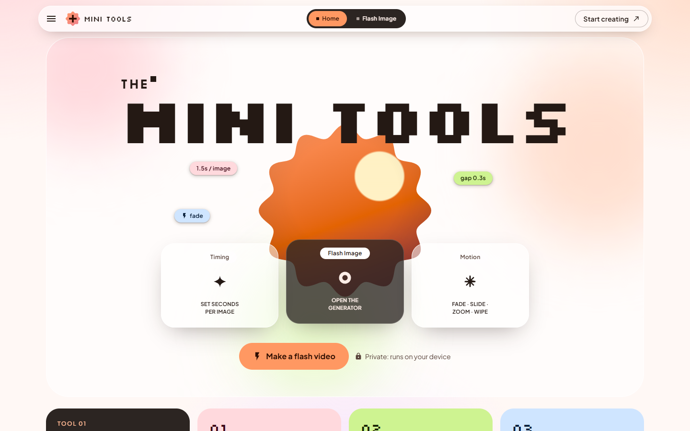
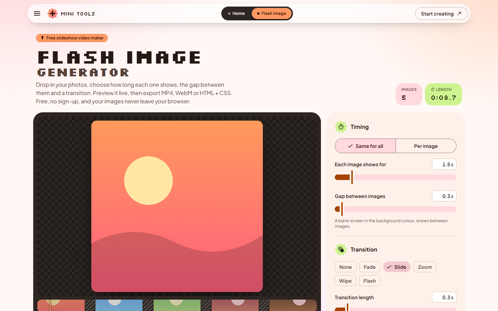
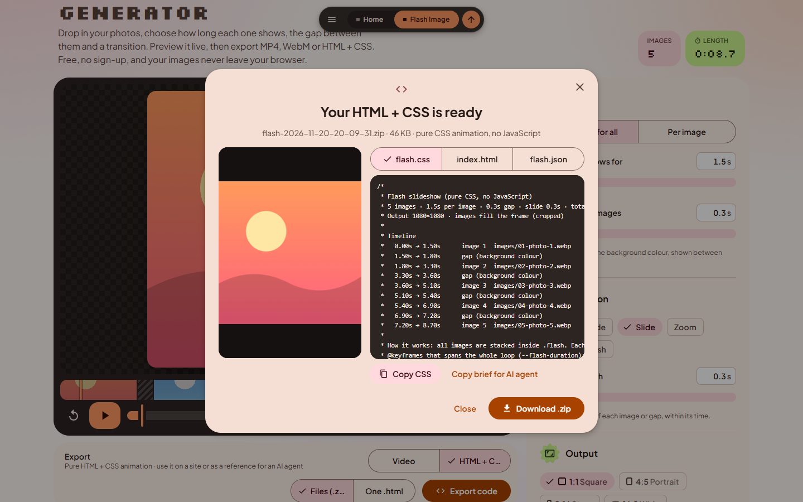
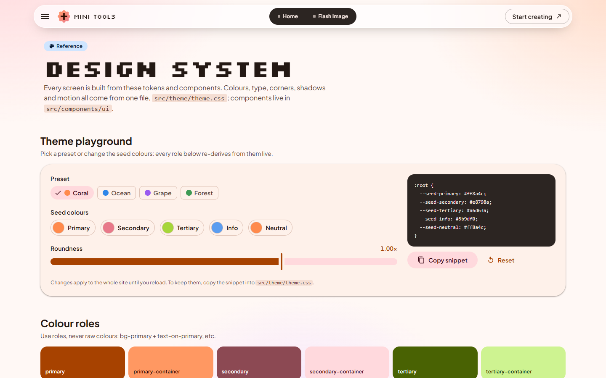

<div align="center">

# Mini Tools

**Free, private, open-source creative tools that run entirely in your browser.**

Start with the **Flash Image Generator**: a free photo slideshow and video maker. Drop in your images, choose how long each one shows, add gaps and transitions, and export an **MP4 / WebM video** or **HTML + CSS**. No sign-up, no uploads, no watermark.

[](LICENSE)
[](https://nextjs.org)
[](https://www.typescriptlang.org)
[](https://tailwindcss.com)
[](https://base-ui.com)
[](#contributing)



</div>

## Contents

- [Why Mini Tools](#why-mini-tools)
- [Flash Image Generator](#flash-image-generator)
- [Privacy](#privacy)
- [How it works](#how-it-works)
- [Tech stack](#tech-stack)
- [Design system: Material 3 on Base UI](#design-system-material-3-on-base-ui)
- [Theming in one file](#theming-in-one-file)
- [Getting started](#getting-started)
- [Project structure](#project-structure)
- [Adding a new tool](#adding-a-new-tool)
- [Deploying](#deploying)
- [FAQ](#faq)
- [Contributing](#contributing)
- [License](#license)

## Why Mini Tools

Most "free" online tools ask you to sign up, upload your files to someone else's server, then stamp a watermark on the result. Mini Tools does the opposite:

| | |
| --- | --- |
| **Free, no catch** | No account, no paywall, no watermark, no ads. Open the page and use it. |
| **Private by design** | Your files are processed on your own device, in the browser. Nothing is uploaded. |
| **Open source** | Every line is here under the MIT license. Read it, run it, fork it. |
| **No learning curve** | Each tool does one job well. No video-editor timeline to learn. |

Mini Tools launches with one tool and is built to grow: every new tool reuses the same design system and theme.

## Flash Image Generator

Turn a stack of photos into a timed slideshow video ("flash" images one after another) in a few clicks.



**Features**

- **Many images at once:** drag-and-drop or pick files, then drag to reorder.
- **Timing your way:** the same duration for every image, or a **custom duration per image** (0.1 to 10 s).
- **Gaps:** a blank screen between images (0 to 5 s) in any background colour.
- **Transitions:** none, fade, slide, zoom, wipe or white flash, with adjustable length.
- **Live preview** with play/pause, seek bar and a visual timeline of images and gaps.
- **Video export:** MP4 or WebM at 1080×1080, 1080×1350, 1080×1920 (stories/reels) or 1920×1080, at 24 / 30 / 60 fps.
- **HTML + CSS export:** the same slideshow as a pure CSS animation (no JavaScript), as a `.zip` (HTML, CSS, JSON timeline, README, images) or a single self-contained `.html`. Use it on a website, or give it to an AI coding agent as an exact reference ("Copy brief for AI agent" is built in).



**Good for:** Instagram / TikTok stories and reels, product photo carousels, quick video recaps, presentation loops, flashcard-style image sequences, and CSS hero animations.

## Privacy

- Images are decoded, previewed and encoded **in your browser**. They never leave your device.
- There is **no backend**: every page is statically prerendered, with no API routes or server actions.
- **No accounts, no analytics, no tracking scripts, no cookies.**
- Because the code is open source, you can verify all of this yourself.

## How it works

| Piece | Implementation |
| --- | --- |
| Timeline | `src/lib/flash/engine.ts` builds a list of image and gap clips. Transitions play at the start of each clip after the first, inside its time. |
| Rendering | A small canvas engine paints any moment of the timeline. Transitions blend full frames from two offscreen buffers, so preview and export are identical. |
| Video export | `canvas.captureStream(0)` + `requestFrame()` pushes frames at exactly the chosen fps into `MediaRecorder` (MP4 where supported, WebM otherwise). Recording runs in real time. |
| HTML + CSS export | `src/lib/flash/codegen.ts` turns the timeline into per-image CSS `@keyframes` (step holds + cubic-bezier transitions matching the canvas easing), plus `flash.json`, zipped with [fflate](https://github.com/101arrowz/fflate). |

## Tech stack

- **[Next.js 16](https://nextjs.org)** (App Router, static prerendering, Cache Components, Turbopack)
- **React 19** with the **React Compiler** (native Rust build)
- **TypeScript** (strict)
- **[Tailwind CSS 4](https://tailwindcss.com)**, mapped to design tokens
- **[Base UI](https://base-ui.com)** (headless, accessible components from the MUI team) plus a custom **Material 3 / Material You** design system
- **class-variance-authority** + **tailwind-merge** for component variants
- **fflate** for zip files

## Design system: Material 3 on Base UI

We use **Base UI, the headless component library from the MUI team**, for everything interactive: dialogs, sheets, toasts, tooltips, sliders, number fields, radio groups, switches, accordions and progress bars. Base UI handles the hard parts (focus trapping, keyboard navigation, ARIA, scroll locking, portals, animation states), while the look is 100% ours: a Material 3 (Material You) expressive style driven by tokens.

> Why not Material UI's styled components? They implement Material **2**. Base UI gives us MUI's battle-tested behaviour with full control over an M3 look, and nothing to override.

All components live in [`src/components/ui`](src/components/ui) and import from one place:

```tsx
import { Button, Dialog, DialogTrigger, DialogContent, DialogHeader, DialogActions, DialogClose, toast } from "@/components/ui";

<Dialog>
  <DialogTrigger render={<Button>Rename</Button>} />
  <DialogContent>
    <DialogHeader title="Rename project" description="Pick a new name." />
    <DialogActions>
      <DialogClose render={<Button variant="text">Cancel</Button>} />
      <Button onClick={() => toast("Saved")}>Save</Button>
    </DialogActions>
  </DialogContent>
</Dialog>;
```

| Component | Notes |
| --- | --- |
| `Button`, `buttonVariants` | filled, accent, tonal, elevated, outlined, text. `buttonVariants()` styles a `<Link>`. |
| `IconButton` + `Tooltip` | `label` is required (it's the accessible name). |
| `Dialog`, `ConfirmDialog` | Modals with focus trap, Esc, scroll lock and animations. |
| `Sheet` | Left, right or bottom sheets (the site menu is one). |
| `toast()` | Snackbars you can call from anywhere, with an optional action. |
| `SegmentedButton`, `ChoiceChips`, `Switch` | Single-select controls. |
| `Slider`, `SliderField`, `NumberField`, `LinearProgress` | Numeric input. |
| `Accordion` | FAQ/details. Closed panels stay indexable (`hidden="until-found"`). |
| `Card`, `Badge`, `ShapedIcon`, `Shape` | Surfaces and M3 expressive shapes. |

Browse them all live at **`/design-system`**.



## Theming in one file

Every colour, font size, corner, shadow and motion curve comes from **[`src/theme/theme.css`](src/theme/theme.css)**:

```css
:root {
  --seed-primary: #ff8a4c;   /* change these five seeds… */
  --seed-secondary: #e8798a;
  --seed-tertiary: #a6d63a;
  --seed-info: #5b9df0;
  --seed-neutral: var(--seed-primary);
}
/* …and every M3 colour role re-derives via oklch(from …) */
```

- **Seeds → roles:** all `--md-sys-color-*` roles are derived from five seed colours (names match Material Theme Builder exports, so you can paste one in).
- **Roundness knob:** `--app-roundness` scales every corner (0 = square).
- **Presets:** `<html data-theme="ocean">` (also `grape`, `forest`), scoped to any element.
- **Guard rail:** Tailwind's default palette is disabled, so only theme colours can be used.
- **Playground:** try seeds and roundness live at `/design-system`, then copy the snippet.

Fonts live in [`src/theme/fonts.ts`](src/theme/fonts.ts).

## Getting started

Requires **Node.js 20.9+** (Node 22 LTS recommended).

```bash
git clone https://github.com/akdoescodes/Mini-tools.git
cd Mini-tools
npm install
npm run dev        # http://localhost:3000
```

| Script | What it does |
| --- | --- |
| `npm run dev` | Development server |
| `npm run build` | Production build (all pages are static) |
| `npm start` | Serve the production build |
| `npm run lint` | ESLint |

## Project structure

```
src/
├─ app/                      routes, metadata, sitemap, robots, OG images
│  ├─ page.tsx               home
│  ├─ tools/flash-image/     Flash Image Generator page (+ JSON-LD, OG image)
│  └─ design-system/         live token & component reference
├─ components/
│  ├─ ui/                    the design system (Base UI + tokens)
│  ├─ flash/                 Flash Image Generator UI
│  └─ AppShell.tsx           header (collapses into a "dynamic island"), drawer, footer
├─ lib/
│  ├─ flash/                 engine (timeline + canvas), media (load/record), codegen (HTML/CSS)
│  ├─ site.ts                name, URL, SEO copy, tool registry
│  └─ cn.ts                  class merging aware of design tokens
└─ theme/
   ├─ theme.css              ★ all design tokens
   └─ fonts.ts               typefaces
```

## Adding a new tool

1. Register it in `TOOLS` in [`src/lib/site.ts`](src/lib/site.ts). It appears in the menu, top bar and sitemap.
2. Create `src/app/tools/<slug>/page.tsx` with its `metadata`.
3. Build the UI from `@/components/ui`. No new buttons, modals or sliders needed.
4. Keep processing in the browser so the tool stays private.

## Deploying

The site is fully static and deploys anywhere that runs Next.js.

[](https://vercel.com/new/clone?repository-url=https%3A%2F%2Fgithub.com%2Fakdoescodes%2FMini-tools)

Set **`NEXT_PUBLIC_SITE_URL`** (e.g. `https://your-domain.com`) so canonical links, the sitemap and social cards use your domain. On Vercel it falls back to the production URL automatically.

SEO is built in: per-page metadata, Open Graph / Twitter images, `sitemap.xml`, `robots.txt`, a web manifest, JSON-LD (`WebApplication`, `FAQPage`, `BreadcrumbList`, `WebSite`) and [`/llms.txt`](public/llms.txt) for AI assistants.

## FAQ

**How do I make a slideshow video from photos for free?**
Open the Flash Image Generator, add your photos, set the seconds per image and the gap, pick a transition and export. No sign-up, no watermark.

**Are my photos uploaded?**
No. Everything runs locally in your browser.

**Can each image have a different duration?**
Yes. Switch Timing to "Per image" and set a time on any image.

**Which formats can I export?**
MP4 or WebM video (browser-dependent), or HTML + CSS.

**Why does exporting take as long as the video?**
The browser records the animation in real time. Keep the tab visible while it exports.

## Contributing

Ideas, bug reports and new tools are welcome.

1. Open an [issue](https://github.com/akdoescodes/Mini-tools/issues) to discuss bigger changes.
2. Fork, create a branch, and build with the design system.
3. Run `npm run lint` and `npx tsc --noEmit` before opening a pull request.

## License

[MIT](LICENSE). Free to use, modify and share.
